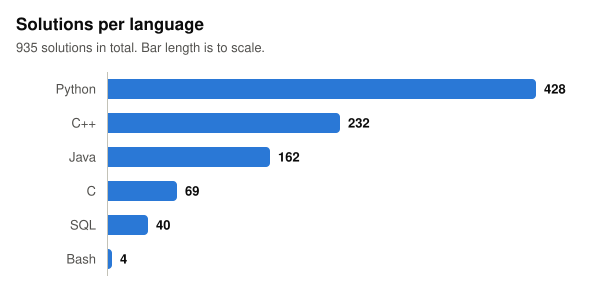

# leetcode

My LeetCode solutions. Sorted into folders by language — each problem is solved once, in whichever
language I felt like at the time. There are 935 solutions in total:

<p align="center">
  
</p>

Files are named `NNNN-slug.ext` (the problem number and title). Each one is standalone — the `Solution`
plus a small `main`/driver that runs the example, so you can just run the file:

```sh
python3 python/0001-two-sum.py
g++ -std=c++17 cpp/0146-lru-cache.cpp -o a && ./a
java java/0215-kth-largest-element-in-an-array.java    # Java 11 or newer
gcc -std=c99 c/0344-reverse-string.c -o a && ./a
```

SQL is written MySQL-style. The four `bash/` ones are the LeetCode shell problems.

Mostly the standard approach for each problem — hash maps, two pointers, BFS/DFS, DP, the usual. Nothing
clever for its own sake.
